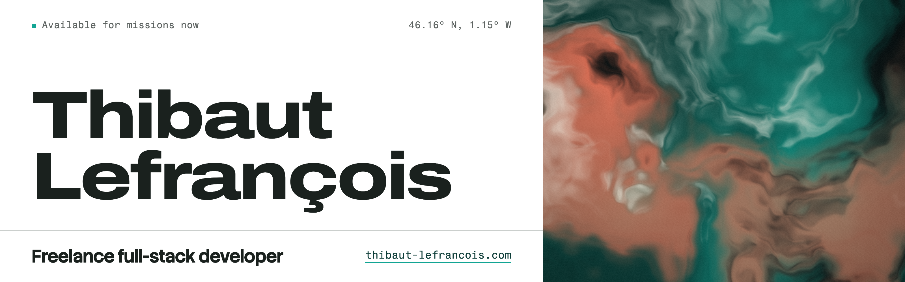

I'm a freelance full-stack developer in La Rochelle. I build web platforms that run in production, and I sweat the parts people see: Kotlin and Java on the server, TypeScript, Vue and React in the browser.

Available for missions now. Remote across France, on-site in Bordeaux, La Rochelle, Niort and around.

[Portfolio](https://thibaut-lefrancois.com) · [CV](https://thibaut-lefrancois.com/cv/thibaut-lefrancois-cv.pdf) · [hello@thibaut-lefrancois.com](mailto:hello@thibaut-lefrancois.com)

## Selected work

Each one has a case study on the portfolio: the constraints, the decisions and what I would do again.

| Project | What it is |
| --- | --- |
| [Youbook](https://thibaut-lefrancois.com/work/youbook/) | The activity marketplace of French tourism destinations, from the import of every provider's catalogue to one cart and one payment. Built for Raccourci Agency. |
| [Steerkit](https://thibaut-lefrancois.com/work/steerkit/) | Craig Reynolds' steering behaviors as small typed functions for JavaScript and Three.js, with no allocation per frame. [On npm](https://www.npmjs.com/package/steerkit), [demos](https://steerkit.thibaut-lefrancois.com). |
| [Ocarina](https://thibaut-lefrancois.com/work/ocarina/) | The ocarina of Ocarina of Time in the browser: 21 songs recognized as you play them. [Play it](https://ocarina.thibaut-lefrancois.com). |
| [Ocean Heartbeat](https://thibaut-lefrancois.com/work/ocean-heartbeat/) | An underwater 3D scene built overnight for the Nuit de l'Info 2024. Prizewinner of the "On veut du gros pixel" challenge. [Explore it](https://ocean-heartbeat.thibaut-lefrancois.com). |

## Playground

Shader and WebGL experiments, small and finished.

- [3D Carousel](https://3d-carousel.thibaut-lefrancois.com): my first shaders, an image carousel that bends as you scroll.
- [Trinity](https://trinity.thibaut-lefrancois.com): Laylow's album as a 3D object. Click it to turn it over.

## Notes

- [One design system for the site and everything I make around it](https://thibaut-lefrancois.com/notes/one-design-system-for-everything-around-me/)
- [Bowser Bros: a vertical Mario in C++ and Qt, built in two and a half weeks](https://thibaut-lefrancois.com/notes/bowser-bros-retrospective/)
- [My first GLSL shaders: a 3D carousel that bends and splits around the cursor](https://thibaut-lefrancois.com/notes/first-steps-glsl-shaders-threejs/)

## Stack

|  |  |
| --- | --- |
| Server | Kotlin, Java, Ktor, Spring Boot, PostgreSQL, Temporal |
| Browser | TypeScript, Vue, React, Astro, Angular |
| Graphics | Three.js, WebGL, GLSL |
| Infra | Docker, Kubernetes |

## Elsewhere

[LinkedIn](https://linkedin.com/in/thibaut-lefrancois) · [X](https://x.com/thibautlfr) · [Instagram](https://www.instagram.com/thibautlfr/)
